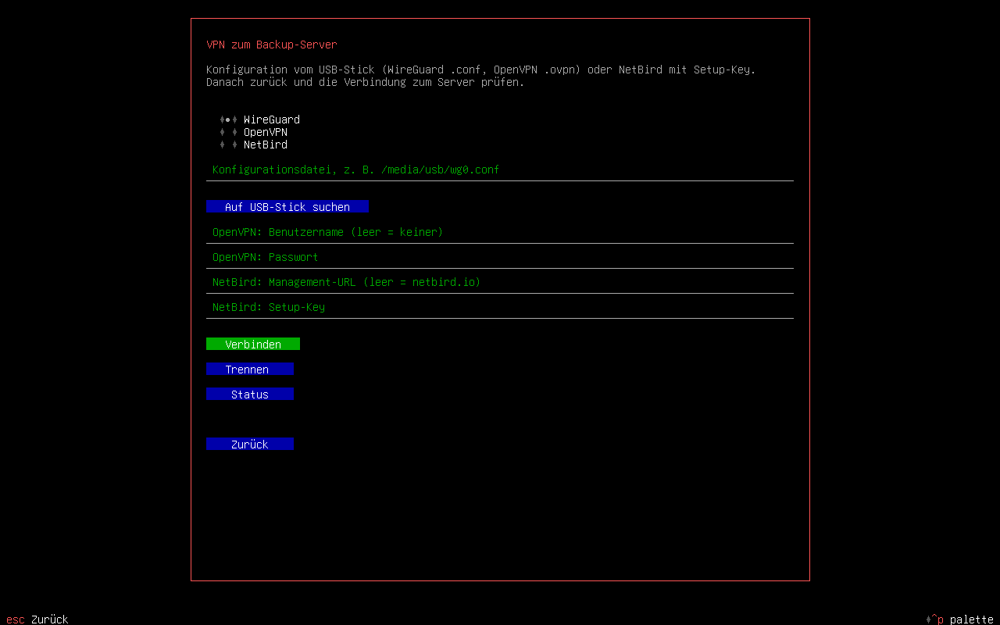
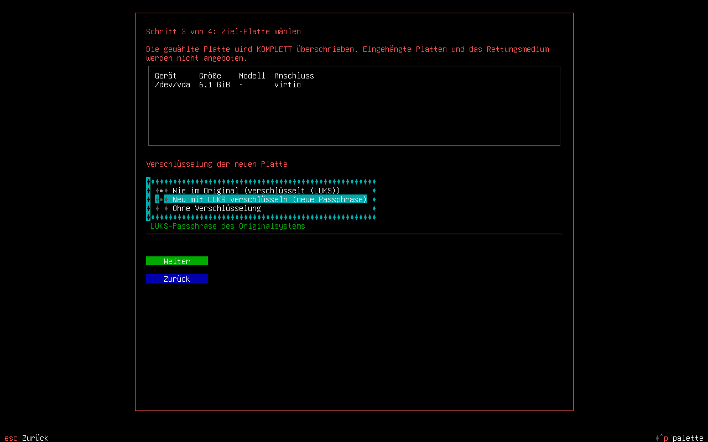
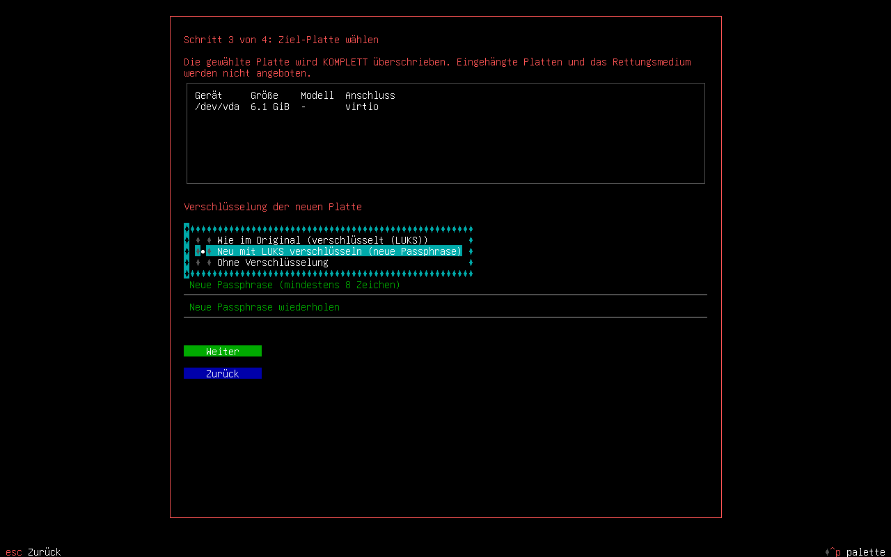

# Restore with the rescue ISO

**English** · [Deutsch](WIEDERHERSTELLUNG.md)

This is how you restore a **full backup** onto a new or empty PC. You need:

| What | Where it comes from |
|---|---|
| The rescue ISO `pbsgui-rescue-<version>-amd64.iso` | Release attachment on GitHub or built yourself (`scripts/build-iso.sh`) |
| A bootable USB stick (≥ 2 GB) | `sudo dd if=pbsgui-rescue-*.iso of=/dev/sdX bs=4M status=progress conv=fsync` (**Careful:** `/dev/sdX` is the stick) |
| The **emergency sheet** | `pbsgui recovery NAME --sheet FILE`, printed or in the password manager |
| The **key** (`key.json`) on a USB stick | `pbsgui key export NAME FILE` – without it an encrypted backup is unreadable |
| The **token secret** of the backup access | Password manager; if necessary create a new token with read permission in PBS |
| The **LUKS passphrase** of the old system | Only if the disk was encrypted |
| A **target disk** at least as large as the old one | It will be overwritten completely! |

> The restore is **destructive** for the target disk. The wizard shows a plan first and requires you to type the device name.
> Mounted disks and the rescue stick are never offered as a target.

The screenshots below show the German interface of the wizard; with an English system language (or `PBSGUI_LANG=en`) the same
screens appear in English.

## 1. Boot from the rescue medium

Plug in the stick, start the PC and choose the stick in the boot menu (usually `F12`, `F11`, `Esc` or `Del`). The
boot menu (UEFI: GRUB, BIOS: syslinux) starts by itself after 5 seconds. After about half a minute
the restore wizard appears automatically on the first console.


No network? `F2` (or the “Network” button) starts `nmtui` (set up Wi-Fi/LAN). You can restart the wizard later with
`pbsgui rescue`. The keyboard is set to German.

## VPN and updates (keys `F3` and `F4`)

**Updates at start:** shortly after booting the ISO checks (if a network is present) whether newer versions of
`pbstui`, `proxmox-backup-client`, WireGuard, OpenVPN and NetBird exist and installs them. The wizard waits for this
for up to 45 seconds (any key skips the wait). Without a network everything is skipped and tried again every 2 minutes;
by hand it works with `F4` in the wizard or `pbsgui update`. If `pbstui` itself was updated, the
wizard offers “Restart”.

**VPN to the backup server:** if the server is behind a VPN, set it up before the first step with `F3` (or the “VPN” button)
(or on the command line with `pbsgui vpn`):

| Type | What you need | Command line |
|---|---|---|
| WireGuard | `wg0.conf` from the USB stick (file name = interface, at most 15 characters) | `pbsgui vpn up wireguard /media/usb/wg0.conf` |
| OpenVPN | `client.ovpn` (certificates next to it or embedded), optionally user and password | `pbsgui vpn up openvpn /media/usb/client.ovpn --user NAME` |
| NetBird | Setup key, for your own instance the management URL | `NB_SETUP_KEY=… pbsgui vpn up netbird --management-url https://netbird.example.org` |

`pbsgui vpn find` looks for configurations on USB sticks, `pbsgui vpn status` shows the tunnels, `pbsgui vpn down` disconnects them.
Passwords and setup keys are never passed as a program argument; OpenVPN credentials only live briefly in RAM and are deleted
on disconnect. Then check the connection to the server as usual.



## Web interface (for servers and VPS)

If you only have a simple console (e.g. on a VPS), you set up the restore in the browser:

1. On the console press `F5` (button “Web”) or run `pbsgui web --daemon`. It shows the **address**, a **random password**
   made of four words, each followed by a two-digit number (e.g. `abacus47-grind83-lemon12-quest66`) and the **fingerprint** of the certificate.
2. Open the address in the browser (a warning about the self-signed certificate appears), **compare** the fingerprint with the
   console and log in with the password.
3. The steps are the same as in the wizard: VPN (paste the configuration), server, snapshot, disk and
   encryption, check the plan, type the device name, live log, restart.

`pbsgui web --status` shows the credentials and `pbsgui web --stop` stops the interface. With `--bind ADDRESS` it only listens on
one address; `--port` and `--timeout` (minutes without a request, after which it switches itself off,
default 60) are adjustable. The page is served in the language of the system (English or German).

**Protection:** HTTPS with a fresh certificate and a fresh password on every activation; rate limiting per address; after 5 wrong
passwords the address is locked out (for growing durations); after 40 failed attempts in total the interface switches itself off
(re-enable on the console). **Honeypot:** an invisible form field and decoy addresses (`/admin`, `/wp-login.php`,
`/.env` …) that only bots visit. Whoever touches them is locked out for hours, only gets delayed answers, and the
console shows the hit. There is only ever one session, it expires after 15 minutes of inactivity, and every change needs a
CSRF token. Wiping a disk requires typing the device name, as everywhere.

## 2. Connection to the backup server

The fields server, datastore, namespace, backup ID and token ID come from your **emergency sheet** (with a
personalized ISO, `scripts/build-iso.sh … --profile NAME`, they are already filled in).


1. Enter the **token secret**.
2. Compare the **fingerprint** with the value on the emergency sheet (or “Fetch fingerprint” and check it).
3. **Key file:** plug in the USB stick and choose “Search USB stick for the key file”, or enter the path by
   hand (e.g. `/media/pbsgui/sdb1/key.json`).


With **Next** the wizard looks for full backups. Only snapshots that contain recovery data are offered
(backups created with `pbsgui … --mode full`).

## 3. Choose a snapshot


The newest is at the top. The wizard now only loads the small archive with the layout data (seconds), not the
whole system.

## 4. Choose the target disk


Choose the disk and decide how the new disk should be **encrypted**:

| Choice | What happens | You need |
|---|---|---|
| **As in the original** (default) | The system is built as it was. If it was encrypted with LUKS, the saved LUKS header is restored. | the old LUKS passphrase (if the original was encrypted) |
| **Re-encrypt with LUKS** | A new LUKS2 container with a new passphrase, even if the original was unencrypted. The data partitions (not EFI and not `/boot`) go into it, `crypttab` and initramfs are adjusted. | a new passphrase (at least 8 characters, twice) and a separate `/boot` partition in the original |
| **Without encryption** | The disk is built unencrypted, the old `crypttab` entry is disabled. | nothing |



With “re-encrypt” the fields for the new passphrase appear:



If the target system has no `cryptsetup-initramfs` yet (the original was unencrypted), the wizard installs
it into the new system; for that the computer needs a network. File system and LVM identifiers stay the same in
all cases; only the LUKS container gets a new UUID with “new”.

### Smaller target disk (“resize”)

If the chosen disk is **smaller** than the original disk (example: original 512 GB with 50 GB used, target 128 GB),
the option **“Resize”** appears below the disk list. Without the tick the wizard aborts with “Target disk too
small”. With the tick it recalculates the layout:

- **The EFI partition and `/boot` keep their size**, as do BIOS boot and unknown partitions.
- **Swap** (partition or LV) is shrunk in proportion target/original, at least 1 GiB, never larger than before.
- All other **partitions and logical volumes** share the rest in proportion to their old sizes, never larger than
  before. Every file system gets at least **used space + 20 % reserve, at least 2 GiB**. Whoever falls to that
  minimum keeps it; the others share the remaining space. The distribution is deterministic.
- If it does not fit, the error message names the **required minimum size** of the target disk.
- **All UUIDs stay the same** (partitions, file systems, LUKS in mode “as in the original”, PV/VG/LV); `fstab`,
  `crypttab` and GRUB stay valid. The partition table is rewritten, the GPT backup header lies at the
  end of the smaller disk. All three encryption modes work.
- The plan in the next step shows **old -> new** for every partition and every LV.

The used space comes from the recovery data (`fsusage.json`, in the backup since pbsgui 0.6). For older
backups pbsgui estimates it from the snapshot size and points this out in the plan.
Not supported: volume groups across several disks, thin pools/snapshots/RAID LVs, extended MBR partitions.

## 5. Check and confirm the plan


You see what is built: partition table, LUKS, LVM, file systems (with the **old UUIDs**, so that `fstab`,
`crypttab` and the GRUB configuration stay valid). To continue type the device name, then
**Restore**. “Dry run” only shows the commands and changes nothing.

## 6. The restore runs


The wizard creates the layout, restores `root.pxar`, binds `/dev`, `/proc`, `/sys` and rebuilds the initramfs and
bootloader in the new system (UEFI including the fallback entry `EFI/BOOT/BOOTX64.EFI`, so that new
hardware boots as well). The duration depends on the amount of data and the network.


When it says “Finished”: remove the rescue stick, **Restart**. With an encrypted disk the boot asks for the
LUKS passphrase.

## VM backups from Proxmox VE (V2P)

Besides pbsgui full backups the ISO can also restore **VM backups** from Proxmox VE (snapshots `vm/<id>/…` with image archives such as
`drive-scsi0.img`) onto **physical disks** (V2P, virtual to physical). Choice in the wizard: tick
“Restore a VM image” in the first step; in the web interface “Kind of restore”; on the command line
`pbsgui rescue vm-snapshots` and `vm-run`.

1. **Snapshot and disks:** every disk of the VM (`scsi0`, `virtio1` …) gets a target disk; disks without a target are not
   restored. The boot disk is recognized from the VM configuration (`boot: order=…`). EFI variables (`efidisk0`) and
   the TPM state of the VM are not written. The target disk must be at least as large as the image.
2. **Writing:** the image is written block by block to the disk with `proxmox-backup-client restore`; the display shows the progress.
3. **Repairs** (all visible in the plan, individually switchable; they apply to Debian and Ubuntu guests):
   - **Size:** if the target disk is larger, the GPT is corrected and the last partition together with LUKS, LVM and file system
     (ext4, xfs, btrfs) is enlarged to the rest of the disk. A file system directly on the disk (without a partition table)
     is only enlarged for ext and never overwritten with a partition table.
   - **Initramfs and bootloader:** `MODULES=most` (drivers for real hardware such as NVMe and AHCI), `update-initramfs`, GRUB for UEFI with
     fallback `EFI/BOOT/BOOTX64.EFI` or for BIOS. An opened LUKS container is named as in the guest's `crypttab`,
     so that the new initramfs asks for the passphrase.
   - **Network:** an interface that no longer exists (e.g. `ens3`) is replaced in `/etc/network/interfaces`, Netplan,
     systemd-networkd and NetworkManager by the only real network card (backup `*.pbsgui-orig`). With several cards
     or patterns such as `Name=en*` pbsgui changes nothing and warns.
   - **Guest services:** `qemu-guest-agent` is switched off and `cloud-init` is disabled with `/etc/cloud/cloud-init.disabled` (nothing is
     deleted); a `console=ttyS0` in the GRUB configuration is reported.
4. **Confirmation:** to start, type **all** target disks. A dry run shows every step without changes.

```bash
pbsgui rescue vm-snapshots --server pbs.example.org --datastore main --auth-id user@pbs!tok --vmid 100
PBSGUI_TOKEN_SECRET=… PBSGUI_LUKS_PASSPHRASE=… pbsgui rescue vm-run --server pbs.example.org --datastore main \
  --auth-id user@pbs!tok --vmid 100 --map scsi0=/dev/nvme0n1 --map scsi1=/dev/sdb \
  --confirm-disk /dev/nvme0n1 --confirm-disk /dev/sdb --dry-run      # look first, then without --dry-run
# switch repairs off: --no-grow --no-initramfs --no-bootloader --no-network --no-services
```

**Limits:** Linux guests only (Windows and Solaris are rejected). Target disks smaller than the image do not work (use the
file-mode backup for that). The repair is only built in for Debian and Ubuntu; for other systems the image is written and
the manual steps are pointed out. **Tested:** in QEMU with UEFI: a VM backup with LUKS, LVM and two disks restored onto larger disks,
it boots, files match, root grew from 3.5 to 7.1 GiB. Not tested: a real backup created by Proxmox VE itself, BIOS guests and Secure Boot.

## Without the wizard: command line

```bash
pbsgui rescue disks                                        # possible target disks
pbsgui rescue keys                                         # look for key files on USB sticks
pbsgui rescue snapshots --server pbs.example.org --datastore main --auth-id user@pbs!tok --backup-id my-pc
PBSGUI_TOKEN_SECRET=… PBSGUI_LUKS_PASSPHRASE=… \
  pbsgui rescue run --server pbs.example.org --datastore main --auth-id user@pbs!tok --backup-id my-pc \
  --keyfile /media/pbsgui/sdb1/key.json --disk /dev/sda --dry-run      # look first, then without --dry-run
# choose the encryption: --encryption keep (default) | new (set PBSGUI_NEW_LUKS_PASSPHRASE) | none
# target disk smaller than the original: --shrink (resize); it is offered automatically in interactive mode
```

## If something does not work

| Message | Cause and remedy |
|---|---|
| “No full backup with recovery data found” | Check the backup ID/namespace. Only full backups from pbsgui 0.2 on (`--mode full`) contain the layout data. |
| “missing key” | The backup is encrypted: provide the exported key file in the first step. |
| “LUKS header … is missing in the backup” | The backup was unencrypted; the header is only stored in encrypted backups. Way out: choose “re-encrypt” or “without encryption”. |
| “New encryption needs a separate /boot partition” | GRUB cannot read an encrypted root file system without its own `/boot`: choose “as in the original” or “without”. |
| “Target disk too small” | The new disk is smaller than the old one: tick “resize” or pass `--shrink`. |
| “Target disk too small, even with ‘resize’ … at least X GiB needed” | The used data plus reserve do not fit: use a larger disk (at least X GiB) or clean up in the original first and back up again. |
| No target disk offered | The disk is mounted or is the rescue stick. Check `lsblk` and `umount`. |
| System does not boot (new hardware) | Start the rescue stick again, do not run `pbsgui rescue` again but proceed manually: mount the target, `chroot`, `update-initramfs -u -k all`, `grub-install`, `update-grub`. |

## Tested

The whole path was played through in QEMU with UEFI firmware: full backup of a Debian 13 test system (GPT, ESP,
separate `/boot`, LUKS, LVM, ext4, swap) into a PBS datastore, restore with the ISO wizard (with
simulated key presses, which is where the images come from) onto an empty disk, then boot of the
restored disk through the fallback bootloader, unlocking with the LUKS passphrase. Checksums,
permissions, owners, links were checked, and that **all UUIDs and PARTUUIDs are identical**. The images show test data
(test server, test token).

The three encryption variants are tested individually: **as in the original** (entirely through the wizard),
**without encryption** (the system boots without a passphrase prompt, `crypttab` disabled) and **re-encrypt**
(the system boots with the new passphrase, `crypttab` points to the new UUID); the last two via the command line in
the ISO. In addition a test with real loop devices checks all three variants.

Not tested: real hardware, BIOS boot of the ISO, Secure Boot, Wi-Fi, file systems other than ext4/vfat/swap in the
VM test (the plan code knows xfs and btrfs and is covered by a unit test).

## Limits

- File-based backup, **not an image**: running databases may be inconsistent.
- Secure Boot and TPM-bound LUKS keys (`systemd-cryptenroll`) are not carried over.
- Version 1: one system disk; btrfs subvolumes, mdadm RAID, ZFS and further disks are not covered
  (they are left out and must be restored by hand).
