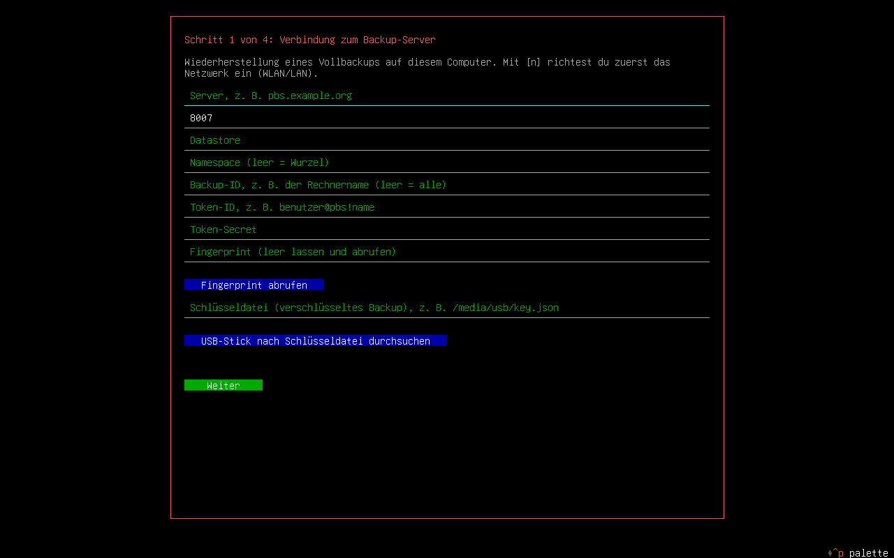
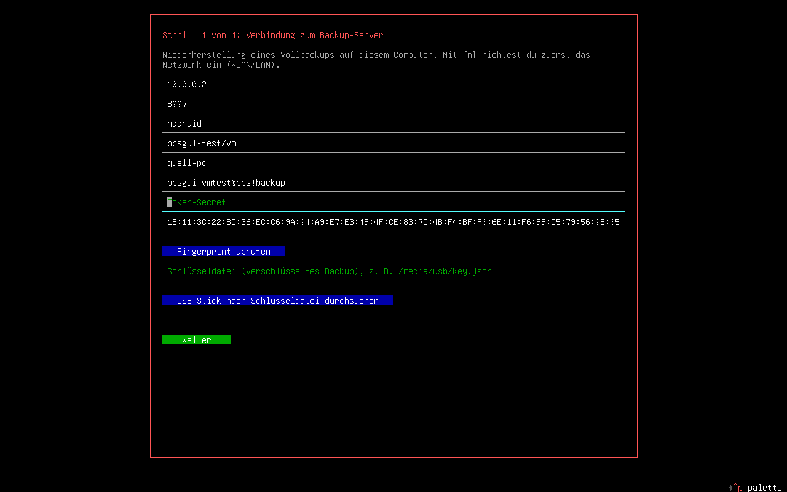
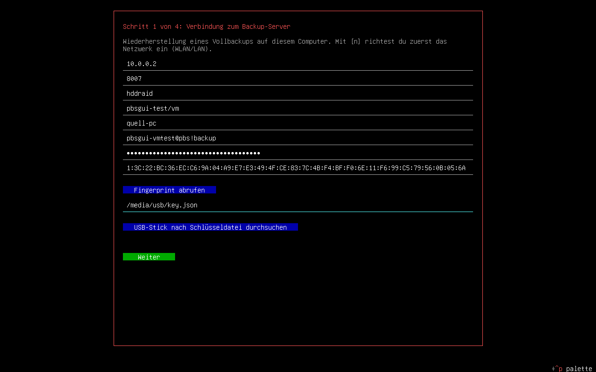
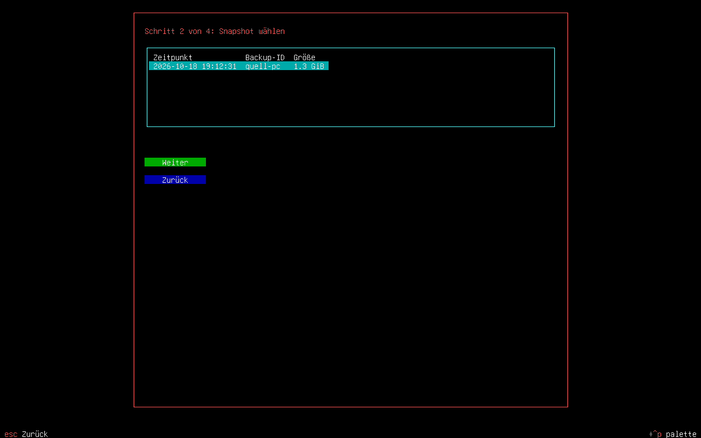
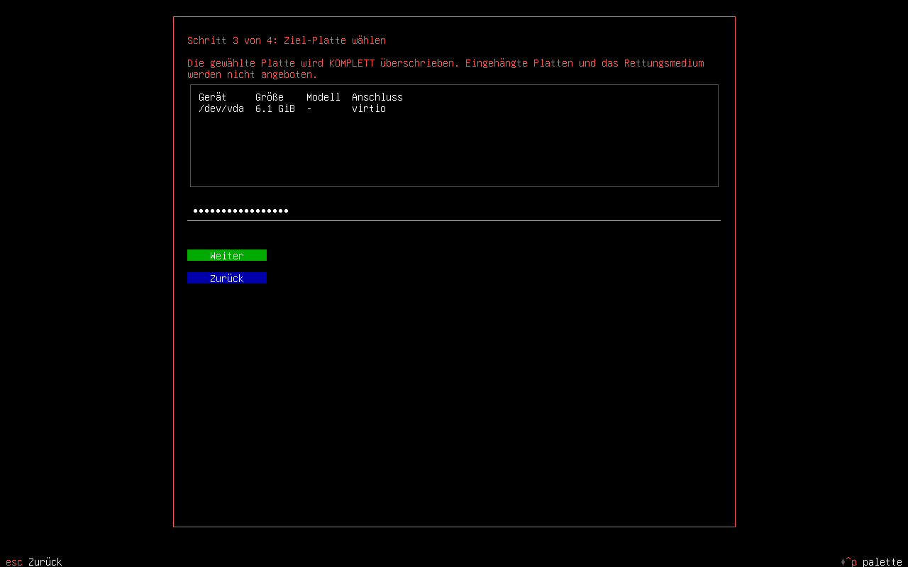
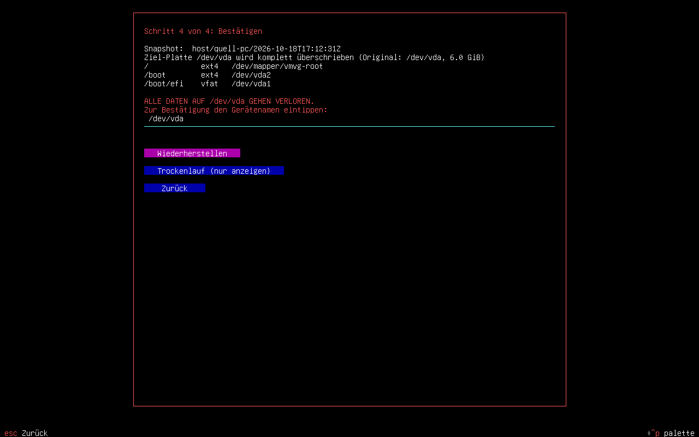
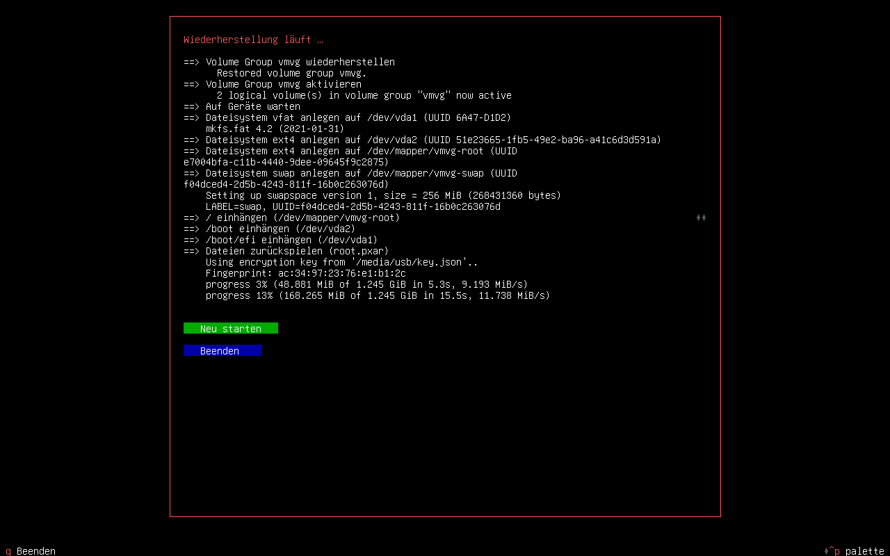
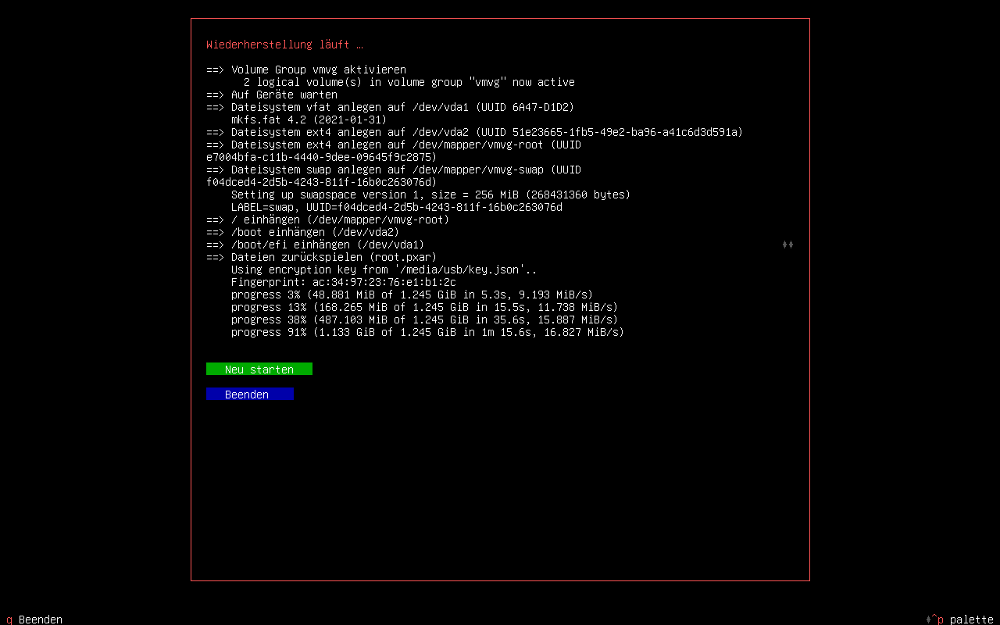

# Wiederherstellung mit der Rettungs-ISO

So spielst du ein **Vollbackup** auf einem neuen oder leeren PC zurück. Du brauchst:

| Was | Wo es herkommt |
|---|---|
| Die Rettungs-ISO `pbsgui-rescue-<version>-amd64.iso` | Release-Anhang auf GitHub oder selbst gebaut (`scripts/build-iso.sh`) |
| Einen USB-Stick zum Booten (≥ 2 GB) | `sudo dd if=pbsgui-rescue-*.iso of=/dev/sdX bs=4M status=progress conv=fsync` (**Achtung:** `/dev/sdX` ist der Stick) |
| Das **Notfallblatt** | `pbsgui recovery NAME --sheet DATEI`, ausgedruckt oder im Passwortmanager |
| Den **Schlüssel** (`key.json`) auf einem USB-Stick | `pbsgui key export NAME DATEI` – ohne ihn ist ein verschlüsseltes Backup nicht lesbar |
| Das **Token-Secret** des Backup-Zugangs | Passwortmanager; notfalls in PBS ein neues Token mit Leserecht erzeugen |
| Die **LUKS-Passphrase** des alten Systems | Nur falls die Platte verschlüsselt war |
| Eine **Ziel-Platte** mindestens so groß wie die alte | Wird komplett überschrieben! |

> Die Wiederherstellung ist **zerstörerisch** für die Ziel-Platte. Der Assistent zeigt vorher einen Plan und verlangt,
> dass du den Gerätenamen eintippst. Eingehängte Platten und der Rettungs-Stick werden nie als Ziel angeboten.

## 1. Vom Rettungsmedium starten

Stick einstecken, PC starten und im Boot-Menü (meist `F12`, `F11`, `Esc` oder `Entf`) den Stick wählen. Das
Medium startet in UEFI und BIOS. Nach etwa einer halben Minute erscheint der Wiederherstellungs-Assistent
automatisch auf der ersten Konsole.



Kein Netzwerk? Mit `n` startet `nmtui` (WLAN/LAN einrichten). Lässt sich der Assistent später neu starten:
`pbsgui rescue`. Die Tastatur ist auf Deutsch gestellt.

## 2. Verbindung zum Backup-Server

Die Felder Server, Datastore, Namespace, Backup-ID und Token-ID kommen von deinem **Notfallblatt** (bei einer
personalisierten ISO, `scripts/build-iso.sh … --profile NAME`, sind sie schon ausgefüllt).



1. **Token-Secret** eintragen.
2. **Fingerprint** mit dem Wert auf dem Notfallblatt vergleichen (oder „Fingerprint abrufen“ und prüfen).
3. **Schlüsseldatei:** USB-Stick einstecken und „USB-Stick nach Schlüsseldatei durchsuchen“ wählen, oder den Pfad von
   Hand eintragen (z. B. `/media/pbsgui/sdb1/key.json`).



Mit **Weiter** sucht der Assistent nach Vollbackups. Es werden nur Snapshots angeboten, die Wiederherstellungsdaten
enthalten (Backups, die mit `pbsgui … --mode full` erstellt wurden).

## 3. Snapshot wählen



Der neueste steht oben. Der Assistent lädt jetzt nur das kleine Archiv mit den Layout-Daten (Sekunden), nicht das
ganze System.

## 4. Ziel-Platte wählen



Wähle die Platte, trage bei verschlüsseltem Original die **LUKS-Passphrase** ein und gehe weiter.

## 5. Plan prüfen und bestätigen



Du siehst, was gebaut wird: Partitionstabelle, LUKS, LVM, Dateisysteme (mit den **alten UUIDs**, damit `fstab`,
`crypttab` und GRUB-Konfiguration gültig bleiben). Zum Fortfahren den Gerätenamen eintippen, dann
**Wiederherstellen**. „Trockenlauf“ zeigt nur die Befehle an und ändert nichts.

## 6. Wiederherstellung läuft



Der Assistent legt das Layout an, spielt `root.pxar` zurück, bindet `/dev`, `/proc`, `/sys` ein und erzeugt im
neuen System Initramfs und Bootloader neu (UEFI inklusive Fallback-Eintrag `EFI/BOOT/BOOTX64.EFI`, damit auch neue
Hardware bootet). Die Dauer hängt von Datenmenge und Netzwerk ab.



Bei „Fertig“: Rettungsstick abziehen, **Neu starten**. Bei verschlüsselter Platte fragt der Start nach der
LUKS-Passphrase.

## Ohne Assistent: Kommandozeile

```bash
pbsgui rescue disks                                        # mögliche Ziel-Platten
pbsgui rescue keys                                         # Schlüsseldateien auf USB-Sticks suchen
pbsgui rescue snapshots --server pbs.example.org --datastore main --auth-id user@pbs!tok --backup-id mein-pc
PBSGUI_TOKEN_SECRET=… PBSGUI_LUKS_PASSPHRASE=… \
  pbsgui rescue run --server pbs.example.org --datastore main --auth-id user@pbs!tok --backup-id mein-pc \
  --keyfile /media/pbsgui/sdb1/key.json --disk /dev/sda --dry-run      # erst ansehen, dann ohne --dry-run
```

## Wenn etwas nicht klappt

| Meldung | Ursache und Abhilfe |
|---|---|
| „Kein Vollbackup mit Wiederherstellungsdaten gefunden“ | Backup-ID/Namespace prüfen. Nur Vollbackups ab pbsgui 0.2 (`--mode full`) enthalten die Layout-Daten. |
| „missing key“ | Das Backup ist verschlüsselt: im ersten Schritt die exportierte Schlüsseldatei angeben. |
| „LUKS-Header … fehlt im Backup“ | Das Backup war unverschlüsselt; der Header wird nur in verschlüsselte Backups gelegt. |
| „Ziel-Platte zu klein“ | Die neue Platte muss mindestens so groß sein wie die alte. |
| Keine Ziel-Platte angeboten | Die Platte ist eingehängt oder ist der Rettungsstick. `lsblk` und `umount` prüfen. |
| System bootet nicht (neue Hardware) | Rettungsstick erneut starten, `pbsgui rescue` nicht erneut ausführen, sondern manuell: Ziel einhängen, `chroot`, `update-initramfs -u -k all`, `grub-install`, `update-grub`. |

## Grenzen

- Dateibasiertes Backup, **kein Abbild**: laufende Datenbanken können inkonsistent sein.
- Secure Boot und TPM-gebundene LUKS-Schlüssel (`systemd-cryptenroll`) werden nicht übernommen.
- Version 1: eine System-Platte; btrfs-Subvolumes, mdadm-RAID, ZFS und weitere Platten sind nicht abgedeckt
  (sie werden ausgelassen und müssen von Hand wiederhergestellt werden).
